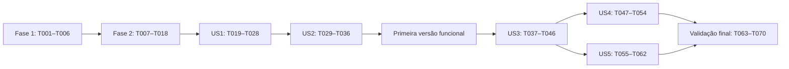

# Tasks: PotatoGene — MVP educacional

**Input**: Documentos de `specs/001-potatogene-mvp/`.
**Prerequisites**: [spec.md](spec.md), [plan.md](plan.md), [research.md](research.md), [data-model.md](data-model.md), [contratos de serviços](contracts/services.md), [contrato de UI](contracts/ui.md), [quickstart.md](quickstart.md) e [constituição 1.0.0](../../.specify/memory/constitution.md).
**Tests**: Obrigatórios pelo pedido do usuário e princípio VI da constituição. Testes de cada história precedem sua implementação; escrever casos comportamentais, observar as falhas esperadas e executar novamente após implementar. Não adiar validação, rollback ou testes essenciais para o fim.
**Organization**: Oito fases, com uma fase por história na ordem P1 → P2 → P3. US1 = variedades; US2 = persistência/validação/erros; US3 = marcadores; US4 = comparação; US5 = dashboard. A geração inicial não implementou tarefas; o estado da execução restrita a T001–T036 está registrado abaixo.

## Format: `[ID] [P?] [Story] Description`

- Cada tarefa usa `- [ ] Tnnn`, caminho exato e, nas fases de histórias, `[USn]`.
- `[P]` identifica trabalho em arquivos distintos que pode ocorrer simultaneamente após concluir os pré-requisitos da fase. Não autoriza ignorar dependências nem editar o mesmo arquivo em paralelo.
- Todas as tarefas começam pendentes. Marcar conclusão apenas após produzir e verificar o resultado exigido; não inventar evidências de testes, desempenho ou avaliação com participantes.

## Path Conventions

Caminhos de implementação são relativos à raiz do repositório: `app.py`, `potatogene/domain/`, `potatogene/services/`, `potatogene/data/`, `potatogene/ui/` e `tests/`, conforme plan.md. `data/potatogene.db` contém dados do usuário; `potatogene/data/` contém código. Os arquivos citados nas tarefas serão criados na implementação, não nesta etapa.

## Phase 1: Setup — ambiente Python e dependências

**Purpose**: Preparar instalação reproduzível e estrutura simples, sem servidor externo.

- [X] T001 Criar os pacotes e diretórios previstos em `potatogene/__init__.py`, `potatogene/domain/__init__.py`, `potatogene/services/__init__.py`, `potatogene/data/__init__.py`, `potatogene/ui/__init__.py` e `tests/`, sem preencher funcionalidades antecipadamente.
- [ ] T002 Preparar venv Windows/Python 3.11, registrar Streamlit 1.50.0 e Pandas 2.3.3 em `requirements.in`, resolver transitivas e fixá-las em `requirements.txt`; produzir `requirements-dev.txt` com o mesmo conjunto mais pytest 8.4.2 e suas transitivas, verificando instalação e pip check em ambiente limpo.
- [X] T003 [P] Configurar `pytest.ini` para descobrir `tests/` e registrar o marker performance, sem plugins adicionais.
- [X] T004 [P] Configurar `.streamlit/config.toml` com servidor em 127.0.0.1, porta 8501, headless habilitado e browser.gatherUsageStats=false, sem recursos remotos.
- [X] T005 [P] Criar `.gitignore` para venvs, arquivos SQLite locais e caches de Python/pytest, preservando o código de `potatogene/data/` e os documentos de especificação.
- [X] T006 Documentar em `README.md` Python mínimo 3.11, estrutura das camadas, instalação com o executável do venv, execução Streamlit e comandos pytest no PowerShell sem exigir ativação do ambiente; identificar os módulos ainda não implementados.

**Checkpoint**: Dependências instaláveis, configurações prontas e instruções básicas reproduzíveis. Ainda não há aplicativo funcional.

---

## Phase 2: Foundational — modelos, validação e SQLite

**Purpose**: Construir a base compartilhada que bloqueia todas as histórias.

**Pré-requisito**: Phase 1 concluída. T007–T013 definem os contratos comuns; T014 escreve seus testes antes da implementação de persistência T015–T017. Nenhuma história começa antes de T018 aprovado.

- [X] T007 Definir VarietyInput e Variedade em `potatogene/domain/models.py`, com campos obrigatórios conforme data-model.md: id INTEGER PRIMARY KEY AUTOINCREMENT — “Gerado pelo banco; estável em edições; não reutilizar IDs excluídos para evitar seleções antigas apontando para novos registros.”; name TEXT NOT NULL — “Nome exibido, de 1 a 100 caracteres após strip; único pela chave abaixo.”; name_key TEXT NOT NULL UNIQUE — “name.strip().casefold(), calculado pelo negócio e gravado pelo repositório junto ao nome.”; origin TEXT NOT NULL — “Procedência, de 1 a 100 caracteres; “Desconhecida” é permitido.”; skin_color TEXT NOT NULL — “Cor da casca, de 1 a 50 caracteres.”; flesh_color TEXT NOT NULL — “Cor da polpa, de 1 a 50 caracteres.”; size TEXT NOT NULL — “Uma das opções: Pequeno, Médio, Grande.”
- [X] T008 Acrescentar MarkerInput e Marcador em `potatogene/domain/models.py`: id INTEGER PRIMARY KEY AUTOINCREMENT — “Gerado pelo banco; estável em edições.”; variety_id INTEGER NOT NULL — “FOREIGN KEY para varieties.id, ON DELETE CASCADE. Não editável pelo formulário de edição do marcador.”; code TEXT NOT NULL — “Código de 1 a 50 caracteres após strip, preservando grafia.”; code_key TEXT NOT NULL — “code.strip().casefold(); único dentro da variedade.”; value TEXT NOT NULL — “Texto de 1 a 100 caracteres; não interpretado como sequência científica, número ou traço biológico.”; source TEXT NOT NULL — “Valor fixo “Demonstrativo — exemplo educacional”, atribuído pelo serviço e persistido.”; inputs não recebem id, chaves ou source editáveis.
- [X] T009 [P] Definir ValidationError por campo, DuplicateError, NotFoundError, InvalidComparisonError, StorageError e IncompatibleDatabaseError em `potatogene/domain/errors.py`, conforme contracts/services.md, sem dependência do Streamlit.
- [X] T010 Implementar validadores compartilhados em `potatogene/domain/validation.py` com as regras “Campo textual precisa ser str; não converter objetos/números/None automaticamente.” e “Aplicar strip, validar tamanho com len (caracteres Unicode, não bytes) e rejeitar vazio.”; rejeitar Cc/Cf, Zl/Zp e quebras de linha; preservar pontuação, acentos e espaços internos visíveis.
- [X] T011 Completar validadores de variedade, marcador e ID em `potatogene/domain/validation.py` aplicando literalmente limites de T007–T008, categorias de tamanho e “Identificadores são inteiros positivos; validação rejeita bool como ID, IDs inexistentes e associação órfã.”; retornar valores limpos e chaves casefold sem remover acentos, condensar espaços internos ou interpretar genética; existência/duplicidade serão verificadas pelos serviços.
- [X] T012 [P] Implementar resolução de caminho em `potatogene/config.py`: padrão `data/potatogene.db` ancorado na raiz pelo local do módulo; POTATOGENE_DB_PATH absoluto ou relativo à raiz; nenhum fallback silencioso diante de falha.
- [ ] T013 [P] Criar fixtures em `tests/conftest.py` para tmp_path, caminhos injetados antes da inicialização, dados demonstrativos e repositório substituto em memória, permitindo testes de negócio sem UI e sem banco real do usuário.
- [ ] T014 Escrever testes parametrizados em `tests/unit/test_validation.py` para todos os campos de T007–T011: 1/N/N+1 caracteres, vazio/espaços, tipo errado, controles/quebras, categorias, IDs bool/inválidos, casefold Unicode e preservação de aspas/acentos; executar e corrigir validadores até passarem.
- [X] T015 Criar DDL fixo em `potatogene/data/schema.sql` para varieties e markers com tipos e obrigatoriedade de T007–T008, CHECKs de comprimento/texto/tamanho/source, UNIQUE(name_key), UNIQUE(variety_id, code_key), FOREIGN KEY com ON DELETE CASCADE; respeitar “Chave normalizada não vazia, sem limite máximo igual ao texto exibido: casefold pode expandir caracteres.”; não criar índices redundantes ou tabelas de comparação/dashboard.
- [X] T016 Implementar conexão e unidade transacional em `potatogene/data/database.py`: sqlite3 compatível com Python 3.11, conexão por operação, foreign_keys habilitado antes de BEGIN, timeout de 5 segundos, isolamento explícito, commit/rollback e close em finally; DDL por instruções individuais e consultas com parâmetros, sem conexão global ou executescript na transação.
- [X] T017 Implementar inicialização idempotente e inspeção em `potatogene/data/database.py`: criar diretório/banco ausente ou SQLite válido vazio, esquema e user_version=1 atomicamente; verificar integrity_check, foreign_key_check, versão, estrutura e regras dos registros/chaves/origem; recusar arquivos ilegíveis ou incompatíveis sem apagar, substituir ou reparar dados.
- [ ] T018 Escrever e executar testes reais de primeira abertura, reabertura, inicialização repetida, banco vazio válido, esquema/versão desconhecidos, dados/chaves/source incompatíveis, NOT NULL/CHECK/UNIQUE/FK, cascade e fechamento/rollback em `tests/integration/test_database.py`, usando somente tmp_path; aprovar os testes de fundação antes das histórias.

**Checkpoint**: Modelos e banco definidos, validadores testados, integridade e inicialização comprovadas em arquivos temporários.

---

## Phase 3: User Story 1 — Gerenciar variedades (Priority: P1)

**Goal**: Entregar listagem, consulta, cadastro, edição, exclusão e cancelamento de variedades.
**Independent Test**: Em catálogo vazio, cadastrar, consultar os cinco campos, editar mantendo ID, cancelar e excluir com confirmação; usar marcador de fixture para comprovar preservação na edição e cascade na exclusão sem depender da UI de US3.
**Pré-requisito**: Phase 2; T019–T021 podem ser escritos simultaneamente conforme contratos existentes. Executar as falhas comportamentais antes de T022–T028.

### Tests for User Story 1

- [ ] T019 [P] [US1] Escrever testes do contrato de variedades em `tests/unit/test_varieties.py` com repositório substituto: CRUD, ordenação, nome duplicado, renomeação para o próprio nome, inexistência e validação independente da interface (FR-001–004, FR-011).
- [ ] T020 [P] [US1] Escrever cenários SQLite de CRUD em `tests/integration/test_repositories.py`: textos com aspas/aparência de SQL como dados, ordenação por name_key/id, ID não reutilizado, marcador preservado na edição e removido na exclusão em cascata (FR-001–004).
- [ ] T021 [P] [US1] Escrever cenários AppTest de catálogo em `tests/ui/test_app.py`: estado vazio, consulta, submissão, confirmação, cancelamento e ausência de escrita ao alterar widgets ou reexecutar; usar banco temporário e contrato de UI (FR-001–004, FR-013).

### Implementation for User Story 1

- [X] T022 [US1] Implementar list/get e busca de unicidade de variedades em `potatogene/data/repositories.py`, com ORDER BY name_key, id, placeholders para IDs/chaves e erros para registro inexistente, sem SQL na UI.
- [X] T023 [US1] Implementar create/update de variedades em `potatogene/data/repositories.py`, gravando campos e chave normalizada na mesma transação, preservando ID/marcadores e convertendo conflito de unicidade em erro apropriado.
- [X] T024 [US1] Implementar delete por ID em `potatogene/data/repositories.py`, verificando existência e remoção em cascata num único commit, sem upsert ou sucesso para ID inexistente.
- [X] T025 [US1] Implementar create/list/get/update/delete em `potatogene/services/varieties.py`, recebendo repositório por dependência, usando validadores, verificando unicidade com exclusão do próprio ID e retornando sucesso somente após commit.
- [ ] T026 [US1] Implementar estado vazio, listagem Pandas via st.table, detalhes e formulário de cadastro em `potatogene/ui/varieties.py`, com cinco campos portugueses, seleção inicial de tamanho não escolhida e gravação somente no submit.
- [ ] T027 [US1] Implementar edição e exclusão em `potatogene/ui/varieties.py`, com seleção por ID, cancelar sem escrita e confirmação identificando variedade e aviso de remoção dos marcadores; manter valores salvos nas consultas seguintes.
- [ ] T028 [US1] Compor serviços, inicialização e tela Variedades em `app.py`, sem SQL, sem cache de catálogo e sem conexão global; executar T019–T021 e registrar em `README.md` a demonstração do catálogo, mantendo o gate de confiabilidade de US2 antes da primeira entrega.

**Checkpoint**: CRUD demonstrável e testado; validar US2 antes de declarar a primeira versão pronta para uso.

---

## Phase 4: User Story 2 — Preservar dados e corrigir entradas (Priority: P1)

**Goal**: Completar a primeira versão com persistência entre sessões, falhas seguras e orientação em português.
**Independent Test**: Reabrir dados após operações confirmadas, rejeitar entradas inválidas mantendo rascunhos, simular falhas de leitura/escrita/commit e verificar rollback sem falso sucesso ou sobrescrita. Casos com marcadores podem usar fixtures antes de US3.
**Pré-requisito**: Phase 3 para integração; validadores e transações essenciais já vêm da Phase 2. T029 e T030 podem ser escritos em paralelo.

### Tests for User Story 2

- [ ] T029 [P] [US2] Escrever injeção de falhas com monkeypatch em `tests/integration/test_failures.py`: leitura/escrita/commit, bloqueio, arquivo inválido/incompatível, fechamento da conexão e falha durante exclusão com marcadores; conferir estado integral anterior e arquivo preservado (FR-010–012).
- [ ] T030 [P] [US2] Acrescentar testes do contrato de erros em `tests/ui/test_app.py`: campo/regra em português, rascunhos mantidos, ausência de traceback/sucesso falso, inicialização indisponível sem lista vazia/dashboard zero e ação Tentar novamente (FR-011–013).

### Implementation for User Story 2

- [ ] T031 [US2] Implementar tradução central dos erros e mensagens em `potatogene/ui/feedback.py`, mostrando erros por campo e orientações portuguesas sem SQL ou traceback; preservar a causa técnica para logging local.
- [X] T032 [US2] Completar tratamento de erros de dados em `potatogene/data/database.py` e `potatogene/data/repositories.py`, distinguindo duplicidade/inexistência de falhas de armazenamento, garantindo rollback/close também em falha de commit e nunca retornando lista vazia por exceção.
- [ ] T033 [US2] Integrar falhas iniciais, logging local no terminal e Tentar novamente em `app.py`, suspendendo ações quando o banco não puder ser lido, sem substituição automática de arquivo ou serviço externo.
- [ ] T034 [US2] Completar estado de formulários em `potatogene/ui/varieties.py`: clear_on_submit=False, chaves por operação/ID, feedback transitório, campos preservados em erro e limpeza após sucesso/cancelamento antes de renderizar widgets no próximo ciclo; impedir repetição de gravação em rerun.
- [ ] T035 [US2] Acrescentar e executar dez ciclos de reabertura em `tests/integration/test_repositories.py`, conferindo campos, associações, origem, edições e exclusões; validar no navegador o catálogo offline e seus textos, registrando evidências em `README.md` (SC-003 e parcela inicial de SC-007).
- [ ] T036 [US2] Executar testes de `tests/unit/`, `tests/integration/` e cenários já criados em `tests/ui/test_app.py`, demonstrar CRUD seguro conforme `specs/001-potatogene-mvp/quickstart.md` e atualizar `README.md` com execução Windows, caminho dos dados e limites desta primeira versão; liberar o marco funcional apenas com verificações aprovadas.

**Checkpoint — primeira versão funcional**: T001–T036 concluídas: catálogo com CRUD, persistência local, validação, rollback, testes e instruções Windows. Ainda faltam marcadores na UI, comparação e dashboard para cumprir integralmente a especificação.

---

## Phase 5: User Story 3 — Organizar marcadores demonstrativos (Priority: P2)

**Goal**: Gerenciar marcadores associados e apresentar sua origem educacional sem validação científica implícita.
**Independent Test**: Usar variedade de fixture, cadastrar dois marcadores, consultar, editar, cancelar/remover e reabrir; verificar código único por variedade e origem fixa. Não depende de comparação ou dashboard.
**Pré-requisito**: US1 + US2. T037–T039 podem ser escritos simultaneamente.

### Tests for User Story 3

- [ ] T037 [P] [US3] Escrever testes do contrato de marcadores em `tests/unit/test_markers.py` para limites de T008/T011, origem fixa, unicidade por variedade, mesmo código em outra variedade, associação inexistente, ID estável e edição sem troca de variedade/source (FR-005–007, FR-011).
- [ ] T038 [P] [US3] Acrescentar integração de marcadores em `tests/integration/test_repositories.py`: CRUD, chaves, relação obrigatória, rollback, reabertura com source intacto e cascade da variedade (FR-004–006, FR-010).
- [ ] T039 [P] [US3] Acrescentar contrato AppTest de marcadores em `tests/ui/test_app.py`: ausência de registros sem afirmação biológica, origem/explicação visíveis, formulários, rascunho inválido e confirmações/cancelamentos (FR-005–007, FR-013).

### Implementation for User Story 3

- [ ] T040 [US3] Implementar list/create/update/delete e buscas de existência/duplicidade de marcadores em `potatogene/data/repositories.py`, com SQL parametrizado, UNIQUE(variety_id, code_key), transações e preservação de variety_id/source nas edições.
- [ ] T041 [US3] Implementar serviços em `potatogene/services/markers.py`, validando código/valor, variedade/registro existente, unicidade com exclusão do próprio ID e atribuindo sempre “Demonstrativo — exemplo educacional”, sem aceitar origem como input do usuário.
- [ ] T042 [US3] Criar listagem e estado vazio de marcadores em `potatogene/ui/markers.py`, apresentando Código, Valor, Origem e explicação acessível de que exemplos não validam ciência nem permitem inferências biológicas.
- [ ] T043 [US3] Criar cadastro/edição em `potatogene/ui/markers.py` com somente Código e Valor editáveis, submit explícito, cancelamento sem escrita e mesma política de rascunho/limpeza segura de US2.
- [ ] T044 [US3] Implementar remoção confirmada em `potatogene/ui/markers.py`, identificando o marcador, permitindo cancelar e preservando a variedade e os demais marcadores.
- [ ] T045 [US3] Integrar serviços em `app.py` e seção de marcadores nos detalhes de `potatogene/ui/varieties.py`, atualizando leituras após sucesso sem duplicar gravações nem perder origem.
- [ ] T046 [US3] Executar T037–T039 e regressões de catálogo/falhas em `tests/`, validar US3 com variedade de fixture e documentar marcadores demonstrativos e seus limites em `README.md`.

**Checkpoint**: Catálogo educacional com variedades e marcadores funcionando; persistência e identidade preservadas.

---

## Phase 6: User Story 4 — Comparar duas variedades (Priority: P2)

**Goal**: Apresentar dados cadastrais e marcadores lado a lado, sem interpretações biológicas.
**Independent Test**: Preparar duas variedades com códigos comuns/exclusivos e outra sem marcadores; conferir cinco campos, alinhamento e ausências; rejeitar seleção inválida ou removida. Não depende do dashboard.
**Pré-requisito**: US1 + US2 + US3 para integração; T047 e T048 podem ser escritos juntos usando registros de fixture.

### Tests for User Story 4

- [ ] T047 [P] [US4] Escrever contrato do serviço em `tests/unit/test_comparison.py`: IDs incompletos/iguais/inexistentes, cinco campos, chaves casefold, códigos com grafias diferentes, marcadores exclusivos, ambos sem marcadores e ausência distinta de valor textual “Não registrado” (FR-006–008).
- [ ] T048 [P] [US4] Acrescentar contrato AppTest de comparação em `tests/ui/test_app.py`, verificando seleção de duas variedades, origem e aviso educativos, dados atuais após edição e invalidação da seleção após exclusão (FR-006–008, FR-013).

### Implementation for User Story 4

- [ ] T049 [US4] Definir ComparisonResult em `potatogene/domain/models.py`, com IDs/nomes, tabela dos cinco campos e dados de marcadores dos dois lados; ausência permanece dado ausente, sem resultado persistido ou escore científico.
- [ ] T050 [US4] Implementar leitura consistente das duas variedades e seus marcadores em `potatogene/data/repositories.py`, numa conexão e transação de leitura, com IDs parametrizados e erro se registro não existir.
- [ ] T051 [US4] Implementar comparação em `potatogene/services/comparison.py`, validando exatamente dois IDs distintos e usando Pandas outer merge por code_key com validate=one_to_one; preservar code/value/source de cada lado e colunas definidas em resultado vazio.
- [ ] T052 [US4] Implementar seletores e tabelas estáticas em `potatogene/ui/comparison.py`, cinco campos e marcadores lado a lado, células ausentes como “Não registrado”, origem/aviso visíveis e orientação para seleção insuficiente/igual/inválida.
- [ ] T053 [US4] Integrar navegação Comparação em `app.py`, reconsultando após solicitação e removendo resultado antigo quando seleção tiver sido excluída; não depender de registros salvos em session_state.
- [ ] T054 [US4] Executar T047–T048 e cenários de comparação/reabertura em `tests/`, conferir no navegador códigos com caixa diferente e variedade sem marcadores e registrar o resultado em `README.md`.

**Checkpoint**: Comparação descritiva completa, sem esconder códigos exclusivos ou inferir parentesco/características.

---

## Phase 7: User Story 5 — Consultar estatísticas (Priority: P3)

**Goal**: Exibir totais de variedades, registros de marcadores, variedades com marcadores e distribuição por tamanho.
**Independent Test**: Três variedades (Pequeno/Médio/Grande) com dois, um e zero marcadores produzem totais 3/3/2 e uma por tamanho; vazio produz zeros; alterações confirmadas atualizam contagens, falhas/cancelamentos não.
**Pré-requisito**: US1 + US2 + US3; não depende do serviço de comparação. Na execução padrão, iniciar após US4. T055 e T056 podem ser escritos juntos.

### Tests for User Story 5

- [ ] T055 [P] [US5] Escrever contrato do resumo em `tests/unit/test_dashboard.py`: vazio, três tamanhos, mesmo código em variedades diferentes contado duas vezes, totais 3/3/2 e mudanças após CRUD (FR-009).
- [ ] T056 [P] [US5] Acrescentar contrato AppTest do dashboard em `tests/ui/test_app.py`: estado vazio, indicadores, três categorias inclusive zeros e contagens atuais após sucesso, cancelamento e falha, sem apresentar zeros após leitura malsucedida (FR-009, FR-012–013).

### Implementation for User Story 5

- [ ] T057 [US5] Definir DashboardSummary em `potatogene/domain/models.py` com total_varieties, total_markers, varieties_with_markers e counts_by_size: “Todos são inteiros não negativos; total de tamanhos igual ao total de variedades.”; Pequeno/Médio/Grande sempre presentes, sem snapshots persistidos.
- [ ] T058 [US5] Implementar agregações em `potatogene/data/repositories.py` numa leitura consistente: COUNT de variedades, COUNT de marcadores, COUNT DISTINCT de variety_id e GROUP BY size; evitar totais multiplicados por joins e acrescentar casos reais em `tests/integration/test_repositories.py`.
- [ ] T059 [US5] Implementar resumo em `potatogene/services/dashboard.py`, preenchendo as três categorias com zero quando ausentes e propagando falha de leitura como erro, nunca como catálogo vazio válido.
- [ ] T060 [US5] Implementar métricas e tabela Pandas via st.table em `potatogene/ui/dashboard.py`, com textos portugueses, zeros no catálogo vazio válido e orientação para cadastro, sem gráficos/filtros adicionais.
- [ ] T061 [US5] Integrar Dashboard em `app.py`, lendo resumo atual a cada consulta relevante, sem cache que inclua alterações canceladas ou resultados obsoletos.
- [ ] T062 [US5] Executar T055–T056 e integrações de resumo em `tests/`, verificar cenário 3/3/2, vazio e distribuição após edição/exclusão e documentar o resultado em `README.md`.

**Checkpoint**: Todas as funcionalidades do MVP educacional foram construídas; falta concluir validação global e evidências da fase final.

---

## Phase 8: Polish & Cross-Cutting Concerns — validação e documentação finais

**Purpose**: Comprovar os critérios de sucesso e concluir a entrega conforme a constituição. Pré-requisito: cinco histórias concluídas.

- [ ] T063 [P] Criar cenário temporário e testes de desempenho em `tests/performance/test_queries.py` com 100 variedades e 2.000 marcadores, vinte consultas por fluxo de listagem/comparação/resumo e marker performance; medir serviços como diagnóstico, sem afirmar que substitui latência percebida no navegador.
- [ ] T064 [P] Consolidar `README.md` com organização dos módulos, responsabilidades, instalação limpa, comandos Windows via python.exe do venv, caminho/inicialização do banco, execução offline, testes, falhas esperadas e limitações científicas/funcionais, conforme quickstart e comportamento implementado.
- [ ] T065 Reinstalar os locks `requirements.txt` e `requirements-dev.txt` em ambientes limpos Windows/Python 3.11 e 3.14, executar pip check e suíte, registrar versões Python/SQLite/pacotes em `README.md` e ajustar locks se necessário preservando 3.11; documentar locks separados somente se exigidos por resoluções distintas.
- [ ] T066 Executar a suíte completa pertinente em `tests/`, incluindo falhas e desempenho, acrescentar regressões automatizáveis para defeitos encontrados e registrar resultados reais em `specs/001-potatogene-mvp/quickstart.md`; não usar o banco real nem marcar sucesso com testes pendentes.
- [ ] T067 Validar todas as telas no navegador local sem acesso externo, conferir português, controles, cancelamentos, erros sem traceback e origem demonstrativa em cada apresentação; registrar SC-005/SC-007 e ajustes necessários em `specs/001-potatogene-mvp/quickstart.md`.
- [ ] T068 Executar avaliação com cinco estudantes/educadores, usando o roteiro em `specs/001-potatogene-mvp/quickstart.md`, e registrar SC-001 (quatro de cinco concluem CRUD sem intervenção em até cinco minutos) e SC-006 (quatro de cinco explicam a natureza demonstrativa); manter pendente se participantes não estiverem disponíveis, sem substituir por testes automatizados.
- [ ] T069 Medir no navegador, do submit ao resultado visível, vinte consultas por fluxo com 100 variedades e 2.000 marcadores; comprovar pelo menos dezenove por fluxo em até dois segundos e registrar equipamento/versões/evidências de SC-002 em `specs/001-potatogene-mvp/quickstart.md`.
- [ ] T070 Revisar conformidade dos nove princípios em `README.md` e comportamento de `potatogene/`, documentar funções públicas e decisões não evidentes nos módulos correspondentes, conferir rastreabilidade FR-001–013/SC-001–007 e atualizar os marcadores concluídos em `specs/001-potatogene-mvp/tasks.md` somente com evidências; corrigir desvios e aprovar a suíte antes de integrar a entrega.

**Checkpoint**: MVP educacional completo validado e documentado; avaliações humanas ou de ambiente ainda pendentes devem permanecer explicitamente pendentes.

---

## Dependencies & Execution Order

### Dependências das fases

Execução padrão: fases 1 a 8 na ordem numérica. O grafo mostra dependências reais: dashboard não depende da comparação; testes independentes de cada história usam fixtures e não exigem execução prévia das telas das demais histórias.

### Dependências dentro das fases

- Setup: T001 → T002; depois T003/T004/T005 podem ocorrer juntos; T006 encerra a preparação.
- Fundação: T007 → T008 (mesmo arquivo); T009 pode ocorrer em paralelo com modelos. T010 → T011; T012 e T013 não compartilham arquivos com validadores. T014 depende de T007–T013; T015 depende dos modelos/regras; T016 depende de schema/config/erros; T017 depende de T016/validadores; T018 encerra o gate.
- US1: testes T019/T020/T021 → repositórios T022 → T023 → T024 → serviço T025 → UI T026 → T027 → composição/validação T028.
- US2: testes T029/T030 → feedback T031 → tratamento de dados T032 → inicialização UI T033 → rascunhos T034 → persistência/offline T035 → marco T036.
- US3: testes T037/T038/T039 → repositório T040 → serviço T041 → UI T042 → T043 → T044 → integração T045 → validação T046.
- US4: testes T047/T048 → resultado T049 → snapshot T050 → serviço T051 → UI T052 → integração T053 → validação T054.
- US5: testes T055/T056 → resultado T057 → agregações T058 → serviço T059 → UI T060 → integração T061 → validação T062.
- Final: T063/T064 podem ocorrer juntos; T065 → T066 → T067 → T068 → T069 → T070 é a sequência padrão de avaliação e revisão.

Implementar testes antes do comportamento de cada história, depois serviços e telas, e aprovar o conjunto antes de avançar. A falha inicial de teste não conclui a história: seu checkpoint exige aprovação após implementar.

### Oportunidades e exemplos de execução paralela

| Contexto | Tarefas simultâneas | Arquivos distintos |
| --- | --- | --- |
| Setup, após dependências | T003 + T004 + T005 | pytest.ini; .streamlit/config.toml; .gitignore |
| Fundação | T009 + T012 + T013, após T008 | domain/errors.py; config.py; tests/conftest.py |
| US1, após fundação | T019 + T020 + T021 | tests/unit/test_varieties.py; tests/integration/test_repositories.py; tests/ui/test_app.py |
| US2, após US1 | T029 + T030 | tests/integration/test_failures.py; tests/ui/test_app.py |
| US3, após marco funcional | T037 + T038 + T039 | tests/unit/test_markers.py; tests/integration/test_repositories.py; tests/ui/test_app.py |
| US4, após US3 | T047 + T048 | tests/unit/test_comparison.py; tests/ui/test_app.py |
| US5, após US3 e sem conflito com US4 | T055 + T056 | tests/unit/test_dashboard.py; tests/ui/test_app.py |
| Validação final | T063 + T064 | tests/performance/test_queries.py; README.md |

Os exemplos são opções de organização futura, não execução nesta etapa. Não executar fases US4/US5 inteiras em paralelo: ambas alteram models.py, repositories.py, app.py e tests/ui/test_app.py. Após US3, apenas testes unitários T047/T055 e depois serviços/telas próprios podem avançar simultaneamente quando suas dependências estiverem prontas; serializar mudanças nos arquivos compartilhados. Também não executar duas tarefas de evidências em quickstart.md simultaneamente.

---

## Implementation Strategy

### MVP First — primeira versão funcional

1. Concluir **T001–T018**: ambiente, modelos, validação, SQLite e testes da base.
2. Concluir **T019–T028**: US1 com CRUD de variedades e interface local.
3. Concluir **T029–T036**: US2 com erros orientados, rascunhos preservados, reabertura, rollback e testes aprovados.
4. Demonstrar o catálogo conforme o checkpoint T036: **36 tarefas obrigatórias para este primeiro incremento funcional**. Validar essa entrega antes de acrescentar as próximas funcionalidades.

US1 isolada demonstra o fluxo principal, mas a primeira versão utilizável inclui US2: simplicidade não permite excluir validação, tratamento de falhas, persistência ou testes. Marcadores de fixture comprovam integridade sem antecipar seu gerenciamento na UI.

### Entrega incremental do MVP educacional completo

1. **T037–T046** acrescentam marcadores demonstrativos e explicações.
2. **T047–T054** acrescentam comparação descritiva.
3. **T055–T062** acrescentam dashboard; ao final de T062, todas as funcionalidades previstas estão implementadas.
4. **T063–T070** completam avaliação, compatibilidade, documentação e revisão. **A entrega integral solicitada exige T001–T070**, não apenas o primeiro incremento.

Executar regressões a cada checkpoint. Restringir melhorias ao escopo atual: sem autenticação, cloud, inferências científicas, gráficos, importação, sincronização ou framework adicional.

### Rastreabilidade e cobertura

| Requisitos/resultados | Tarefas principais |
| --- | --- |
| FR-001–004: catálogo e integridade da exclusão | T007, T015–T028, T032, T038 |
| FR-005–007: marcadores, origem e rigor educacional | T008, T015, T037–T046, T047–T054, T067–T068 |
| FR-008: comparação | T047–T054 |
| FR-009: estatísticas | T055–T062 |
| FR-010: armazenamento local | T004, T012, T016–T018, T029, T033–T036, T065, T067 |
| FR-011–012: validação e falhas | T009–T018, T019, T029–T036, T037–T041, T066 |
| FR-013: português | T021, T026–T027, T030–T031, T039, T042–T044, T048, T052, T056, T060, T067 |
| SC-001/SC-006: conclusão de tarefas e compreensão | T068 |
| SC-002: desempenho percebido | T063, T069 |
| SC-003: dez ciclos de persistência | T035, T038, T066 |
| SC-004: entradas/limites/rollback | T014, T018–T020, T029–T030, T037–T038, T066 |
| SC-005: exatidão de comparação/dashboard | T047–T054, T055–T062, T067 |
| SC-007: operação offline e português | T035–T036, T067 |

## Notes

- Total: 70 tarefas — Setup 6; Fundação 12; US1 10; US2 8; US3 10; US4 8; US5 8; Validação final 8.
- Todas as tarefas têm IDs sequenciais, caminhos e marcadores de história quando aplicável; 20 tarefas possuem `[P]`.
- Trechos normativos dos campos vêm de data-model.md; a obrigatoriedade é reforçada no esquema e as invariantes são verificadas no negócio, sem depender dos widgets.
- A avaliação humana e os testes no ambiente real precisam de evidências efetivas; manter suas tarefas pendentes quando não tiverem sido executadas.
- Apenas este arquivo é gerado por esta etapa. Instalação, código, banco, testes e execução descritos aqui pertencem à implementação.

## Estado da execução MVP First — 2026-10-13

Escopo solicitado: somente T001–T036. Código de catálogo, interface e testes foi escrito, mas **o marco funcional T036 ainda não está aprovado**.

- **19 tarefas verificadas e concluídas**: T001, T003–T012, T015–T017, T022–T025 e T032. Evidências: arquivos/configurações, sintaxe Python 3.11, separação de camadas e vinte cenários auxiliares executados com biblioteca padrão em Python 3.14.6/SQLite 3.50.4, incluindo CRUD, validação, integridade, rollback, fechamento e dez reaberturas.
- **17 tarefas pendentes de T001–T036**: T002, T013–T014, T018–T021, T026–T031 e T033–T036. Há código e testes escritos para essas partes, mas dependências, fixture/suíte pytest, interface AppTest/navegador, locks e entrega ainda não foram comprovados.
- pip e o download de Python 3.11 falharam por restrição de rede (WinError 10013). `python -m pytest` retornou “No module named pytest”; Streamlit também não está instalado. Não há confirmação de teste pytest aprovado, funcionamento no navegador/offline ou runtime Python 3.11.
- requirements.txt/requirements-dev.txt contêm versões diretas; geração e validação do lock transitivo continuam pendentes em T002.
- Os cenários auxiliares **não substituem pytest**. Instruções de instalação, execução, validação e evidências em [README.md](../../README.md).
- **T037–T070 não foram executadas nem marcadas**; nenhuma funcionalidade de gerenciamento de marcadores, comparação ou dashboard foi criada.
